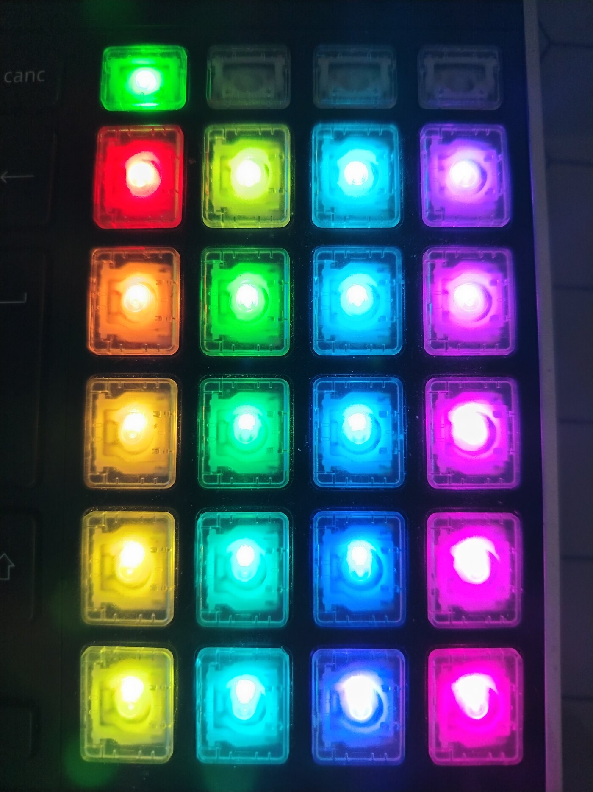
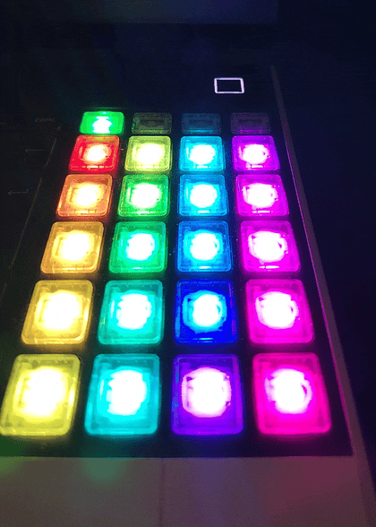

# Framework Laptop 16 RGB Macropad: per-key colour from the host

A QMK firmware patch for the Framework Laptop 16 RGB Macropad that lets software
on the host give each key its own colour (color) while the keyboard is running.
The stock firmware only sets one colour for all 24 keys.

The patch adds VIA's keyboard-specific custom channel, so a host program can set
a colour per key over raw HID without reflashing anything.
[docs/ANATOMY.md](docs/ANATOMY.md) maps the firmware stack and
[docs/PROTOCOL.md](docs/PROTOCOL.md) has the bytes.

Download the image from the
[v0.1.0 release](https://github.com/GBra-4-669/framework16-macropad-rgb/releases/tag/v0.1.0)
and flash it with [flash-macropad.py](flash-macropad.py), or build it from the
tree.

It exists for one use. A deck panel on the screen paints a grid of actions, the
macropad is painted the same way from the same table, and a key is found by
matching it to the panel instead of counting from a corner.

## Why this needs firmware

VIA can talk to the shipped firmware, and what it can set on the RGB matrix
channel is global: brightness, effect, effect speed, hue, saturation. One colour
for all 24 keys, or an effect that cycles them all together. VIA also has a
keyboard-specific custom channel, channel 0, and that is where per-key control
belongs, but the macropad's shipped firmware does not implement it. Framework's
own `qmk_hid` exposes the same global RGB controls, not a per-key API.

The alternative was a firmware patch. This is it: channel 0, the layer colour on
the channel the firmware already exposes, and nothing else in QMK changed. After
the first flash, changing the palette is a HID write from userspace: no rebuild,
no reflash.

## The hardware

| | |
|---|---|
| Module | Framework Laptop 16 RGB Macropad, an Input Module that clips into the laptop |
| Keys | 24, in 4 columns and 6 rows |
| MCU | RP2040, 264 KiB SRAM, 1 MiB QSPI flash |
| USB | vendor `0x32AC`, product `0x0013` |
| LEDs | 24, behind one IS31FL3743A driver |
| Matrix | 4 rows by 8 columns in the firmware, 24 positions used |
| Bootloader | RP2040 ROM bootloader, mass storage with the label `RPI-RP2` |
| Stock firmware | Framework's QMK fork, v0.3.1 |

The keyboard definition is not in upstream QMK. It lives in
[FrameworkComputer/qmk_firmware](https://github.com/FrameworkComputer/qmk_firmware)
on the `fl16-2025` branch, so building means cloning that fork rather
than `qmk/qmk_firmware`. The module itself is hot swappable.

## Build

From a shell with `arm-none-eabi-gcc` installed:

    git clone --branch fl16-2025 \
        https://github.com/FrameworkComputer/qmk_firmware.git ~/qmk_firmware
    cd ~/qmk_firmware
    git checkout 11c49db          # the commit this image was built from
    git submodule update --init --depth 1
    python3 -m venv ~/.local/share/qmk-venv
    ~/.local/share/qmk-venv/bin/pip install qmk
    ~/.local/share/qmk-venv/bin/pip install -r requirements.txt

    R=/path/to/framework16-macropad-rgb
    K=keyboards/framework/macropad
    cp $R/$K/panel_palette.c $K/
    cp $R/$K/rules.mk $K/
    mkdir -p $K/keymaps/palette
    cp $R/$K/keymaps/palette/keymap.c $K/keymaps/palette/

    QMK_HOME=$PWD ~/.local/share/qmk-venv/bin/qmk compile \
        -kb framework/macropad -km palette

The result is `framework_macropad_palette.uf2` in the root of the tree.

One trap before you start: on Python 3.12 and later the QMK
CLI dies while reading `info.json` with `AttributeError: module 'ast' has no
attribute 'Num'`, and the makefile reports it as `Platform not defined`, which
points nowhere near the cause. The fix is one `ast.Num` check in
`lib/python/qmk/math.py`, or a Python 3.11 venv.
[docs/BUILD.md](docs/BUILD.md) has the patch, the toolchain packages, the
expected image header and the sha256 to compare against.

## Flash

> **A flash replaces the firmware, and a rebuild with a different date resets
> the EEPROM keymap on first boot.** Both are recoverable: Framework publishes
> the stock image and an erase image, and the module enters an RP2040 bootloader
> that appears as a USB drive. Back the keymap up first. `flash-macropad.py` does that automatically and writes it back after
> the flash. It uses `sudo` to mount the volume, copy the image, sync it,
> compare it, unmount it and re-trigger udev; opening the module does not. Read
> the script before you run it.

Install the udev rule once, so the module's hidraw node is readable as your user:

    sudo cp udev/99-framework-macropad-via.rules /etc/udev/rules.d/
    sudo udevadm control --reload-rules && sudo udevadm trigger

Then, as your user:

    python3 flash-macropad.py                  # flash firmware-panel-palette.uf2
    python3 flash-macropad.py other.uf2        # flash another image
    python3 flash-macropad.py --status         # print the state, change nothing
    python3 flash-macropad.py --dump out.hex   # save the EEPROM keymap
    python3 flash-macropad.py --restore out.hex  # put a saved keymap back

The script checks every block of the image and compares it with
`firmware-panel-palette.uf2.sha256` before it touches the module, prints what it
is about to do, and waits for you to type `flash`. It finds the bootloader
volume by its label rather than by a device name, and it only accepts a volume
that appeared after the jump, so a second board sitting in its bootloader does
not get this image written to it. It also compares sha256 of the copy against the
source after writing it; that catches a copy that went wrong, but it runs after
the module has rebooted, so the check that matters is the one before. Every path
is an argument or next to the script. The `.sha256` file catches a bad download
or a bad copy; anyone replacing the image can replace the checksum too, so it is
not a signature.

What it reports when it is done:

    $ python3 flash-macropad.py --status
    macropad at /dev/hidraw9
    layer colour (hue, sat): (128, 255)
    layer/changes/state: (0, 4, 1)
    default layer/changes/state: (0, 4, 1)
    cell 0: (255, 0, 0)

`--status` prints the layer colour and the change counter, which is how a
palette that did not update gets traced. [docs/FLASHING.md](docs/FLASHING.md)
has the manual procedure, the failure modes, and the way back to stock
firmware.

## What is in this repository

This is a patch, not a buildable tree. Nothing here compiles on its own: the
three files under `keyboards/` are copied into Framework's fork and built there.
If you just want to try it, the built image is included and there is nothing to
compile.

| Path | What it is |
|---|---|
| `keyboards/framework/macropad/panel_palette.c` | the whole addition: palette, painting, the VIA channel, diagnostics |
| `keyboards/framework/macropad/keymaps/palette/keymap.c` | Framework's default keymap with the layer hooks removed, see [Lessons and traps](#lessons-and-traps) |
| `keyboards/framework/macropad/rules.mk` | Framework's two settings plus the line that puts `panel_palette.c` in the build |
| [`firmware-panel-palette.uf2`](https://github.com/GBra-4-669/framework16-macropad-rgb/releases/download/v0.1.0/firmware-panel-palette.uf2) | the built image, 113,664 bytes, also attached to the v0.1.0 release |
| [`firmware-panel-palette.uf2.sha256`](https://github.com/GBra-4-669/framework16-macropad-rgb/releases/download/v0.1.0/firmware-panel-palette.uf2.sha256) | the checksum the flasher checks the image against, and which the release carries |
| `flash-macropad.py` | keymap backup, bootloader jump, flash, verify, keymap restore |
| `keymap-dumps/` | three EEPROM keymap dumps, including the one the module runs, and the format |
| `udev/99-framework-macropad-via.rules` | hidraw access as a normal user |
| `tests/` | tests for the flasher's pure functions, run by `.github/workflows/tests.yml` |
| `SOURCE.md` | what went into the binary: commit, submodules, the two tree patches, and a written offer |
| [`docs/`](docs/README.md) | anatomy, build, flashing and protocol notes, and the dated session log |

If you want to understand the firmware rather than just flash it,
[docs/ANATOMY.md](docs/ANATOMY.md) maps the stack the patch sits in and walks
through `panel_palette.c` in reading order.

The host side is not here. The panel widget, the key watcher and the palette
table are a personal project and stay private. They are also not required: the
firmware exposes a generic HID channel, and [docs/PROTOCOL.md](docs/PROTOCOL.md)
documents every byte with a small Python client, so any program can set the
colours.

## The palette protocol (VIA custom channel 0)

The host talks to the firmware through VIA's raw HID interface. Reports are 32
bytes both ways, byte 0 is the command, and there is no request id. Channel 0 is
the keyboard-specific channel; this firmware implements it like this:

| Command | Bytes | Answer |
|---|---|---|
| set a cell | `07 00 <cell> <r> <g> <b>` | echo |
| get a cell | `08 00 <cell>` | `08 00 <cell> <r> <g> <b>` |
| save | `09 00 <cell>` | echo, nothing is stored |

A cell is a position on the 4 by 4 panel grid, row-major from the top-left:
`cell = (keypad row - 1) * 4 + column`, where the keypad row is 1-based (1 to 4)
and the column is 0-based (0 to 3). There are 15 panel cells, because the
sixteenth position on that grid is a key the panel does not use. Writing to cell
15 is accepted and nothing is drawn; value ids 16 to 255 are refused with
`id_unhandled` before any array is indexed. The full table, with the LED index
for each cell, is in
[docs/PROTOCOL.md](docs/PROTOCOL.md#which-cell-is-which-key).

The nine keys outside the panel are the four layer keys in the top row, the four
keys in the bottom row and the key at row 4 column 3. They show the active
layer's colour at 30 percent brightness.

The palette lives in RAM and belongs to the host. The firmware does not save it:
a copy in EEPROM would let the keypad show colours the panel stopped using while
the module was unplugged.

The channel also reports layer state, which a colour cannot:

| `value_id` | Answer |
|---|---|
| `F0` | active layer, layer changes since boot, `layer_state` low byte |
| `F1` | the same layer and change count, then `default_layer_state` low byte |

The layer a keymap selects is also reported as an HSV colour on VIA's own RGB
matrix channel, channel 3, because that is a signal the shipped firmware already
exposes and the panel can read it without knowing anything about this patch. The
four layer keys in the keymap this was built for are called tc0 to tc3:

| Layer selected | Key | Hue | Saturation |
|---|---|---|---|
| 0 | tc0 | 128 | 255 |
| 1 | tc1 | 85 | 255 |
| 2 | tc2 | 42 | 255 |
| 3 | tc3 | 0 | 255 |

Full video: [macropad.mp4](docs/images/macropad.mp4).

Only layer 0 is painted by this patch. On layers 1 to 3 the configured effect
paints the matrix as it did before, because the palette belongs to the panel and
the panel is not up on those layers. The layer colour write does set brightness
back to full; see the limits below.

## Measurements

Numbers you can check here:

| What | Value |
|---|---|
| Keys | 24, in 4 columns by 6 rows; 15 of them are panel keys |
| Full palette push | 45 bytes of colour in 15 reports, 32 bytes each on the wire |
| EEPROM keymap | 640 bytes, read or written in 23 chunks of 28 |
| Image | 113,664 bytes, 222 UF2 blocks of 256 payload bytes |
| Layer state | one HID read, so the panel does not have to poll the keypad |

Two timings come from the host-side tool, which is not in this repository, so
they cannot be checked here. The panel opens about 0.09 s after a layer key, and
the process costs 9 to 13 percent of one core across the key watcher, the gate
and the refresh. Those were
measured during the session and are written up in the
[session log](docs/session-2026-09-16.md#what-it-costs-on-the-host). There is no
harness for them here, so they are notes rather than a benchmark.

## Lessons and traps

Most of these are not specific to this macropad.

1. Framework intercepts VIA's bootloader command. Command `0x0B` does not
   reach QMK: `keyboards/framework/factory.c` takes it over and reads the next
   byte as a factory command, and `0xFE` is the bootloader. The jump is
   `[0x0B, 0xFE]`. Plain `[0x0B]` is ignored and logged as `Unknown factory
   command: 0`, and `QK_BOOT` written into the EEPROM keymap did nothing here.

2. The bootloader volume is not a fixed device. It can appear as a partition
   of a new disk or as the disk itself, and the names differ by bus. Mount the
   node `lsblk` labels `RPI-RP2`, never a remembered `/dev/sdX`.

3. A rebuilt image resets the dynamic keymap. The first one changed 72 of 320
   keycodes, because the module came back on Framework's compiled layout instead
   of the remapped one. The cause is QMK's EEPROM validity magic, which is
   derived from the build date, so a new build invalidates the stored keymap and
   a reflash of the same image does not. Dump the 640-byte keymap before flashing
   and write it back after, then read it out again to check.

4. Framework's layer hooks collide with a user layer map. Their default
   keymap runs `layer_off(_FN)` from `led_update_user` when numlock is on, and
   `_FN` is layer 1. With an EEPROM keymap whose layer 1 is tc1, every numlock
   update cleared the layer that had just been selected, so tc1 behaved like tc0
   and the panel never saw a change. The build uses a keymap with that hook
   removed, `-km palette`. The full account is in the
   [session log](docs/session-2026-09-16.md#the-layer-hook-collision).

5. The udev ACL can fail to survive re-enumeration. After a flash the node
   came back `root:root 0600` with no ACL, and the module is unreadable. The
   shipped rule relies on `uaccess` and the flasher re-triggers udev;
   [FLASHING.md](docs/FLASHING.md#udev) shows the optional `GROUP="input"`
   fallback and what it costs.

6. VIA's raw HID has no request id. Two writers can read each other's
   replies, and a late answer to someone else's question looks like the answer to
   yours. The host-side tool holds a lock and drains stale reports before every
   write.

7. The LED order is not the visual order. The driver map in `macropad.c` was
   re-arranged so the LED ids follow the physical positions. The cell table came
   out of `g_led_config`, not from a drawing, and a drawing would have painted the
   neighbours instead.

## What is not included

* The deck panel and the host-side key watcher. They are a personal project and
  are not public. The firmware does not depend on them.
* A configurator or a palette editor. VIA can still edit the keymap, and the
  palette is whatever your program writes.
* A Windows or macOS helper. The protocol is plain raw HID, but the flasher is
  Linux: it uses udev and mounts the bootloader volume.
* Support for the other Framework keyboards. The patch assumes the macropad's
  matrix and LED map.
* Persistence of the palette across a replug, see the protocol section.
* Tests of the firmware. There is no emulator in which a fake LED matrix would
  prove anything, so the firmware is only checked on the module. The flasher's
  pure functions are tested, and `.github/workflows/tests.yml` runs those.

## Limits of the shipped image

Known issues in this image, planned for v0.2:

* A layer change sets the layer colour at full value, so it also puts matrix
  brightness back to maximum and overrides a brightness set in VIA.
* The `_kb` hooks do not chain to the `_user` versions, so a keymap that defines
  `layer_state_set_user` or `rgb_matrix_indicators_advanced_user` will not have
  them called.
* The compiled keymap has no layer key; it is what a hand flash leaves behind,
  and it can only reach layer 0. The flasher restores the EEPROM keymap, which
  has the layer keys.
* At boot, channel 3 reports the colour loaded from EEPROM until the first layer
  change. Read `0xF0` if you need the layer before then.
* The layer colour has four hues, so layers 4 to 9 reuse them. Use `0xF0` past
  layer 3.

## Credits

The hardware, the keyboard definition and the firmware this patch sits on are
Framework's. The macropad definition is in
[FrameworkComputer/qmk_firmware](https://github.com/FrameworkComputer/qmk_firmware),
branch `fl16-2025`, and `keymaps/palette/keymap.c` is their keymap with the layer
hooks removed. QMK and VIA are the layers underneath:
[QMK](https://github.com/qmk/qmk_firmware) for the firmware framework, and
[VIA](https://www.caniusevia.com) for the raw HID protocol this firmware answers.

`panel_palette.c`, the changes to the keymap and `rules.mk`, the flasher, the
tests and the documentation are mine, written by Giulio Bramanti. They are
licensed GPL-2.0-or-later. [LICENSE](LICENSE) has the full text,
[NOTICE](NOTICE) says which file is whose, and [SOURCE.md](SOURCE.md) records
what went into the binary.

Framework, Framework Laptop 16 and RGB Macropad are trademarks of Framework
Computer Inc. This is a personal project, not a Framework release, and not
supported by them.
